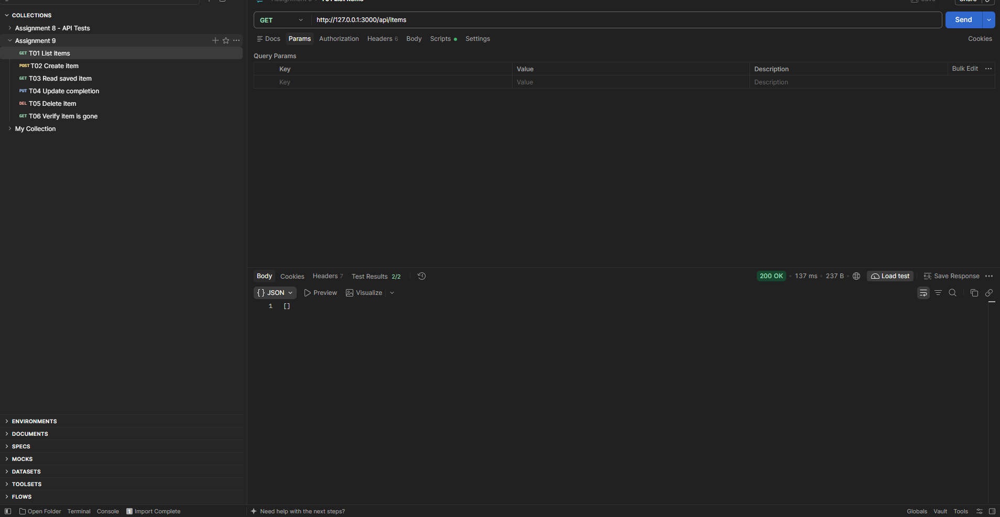
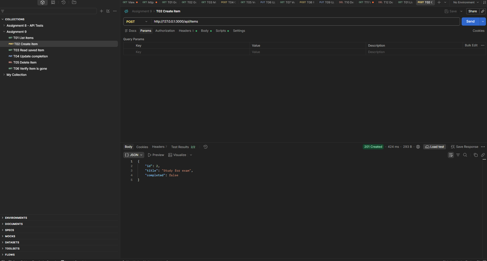
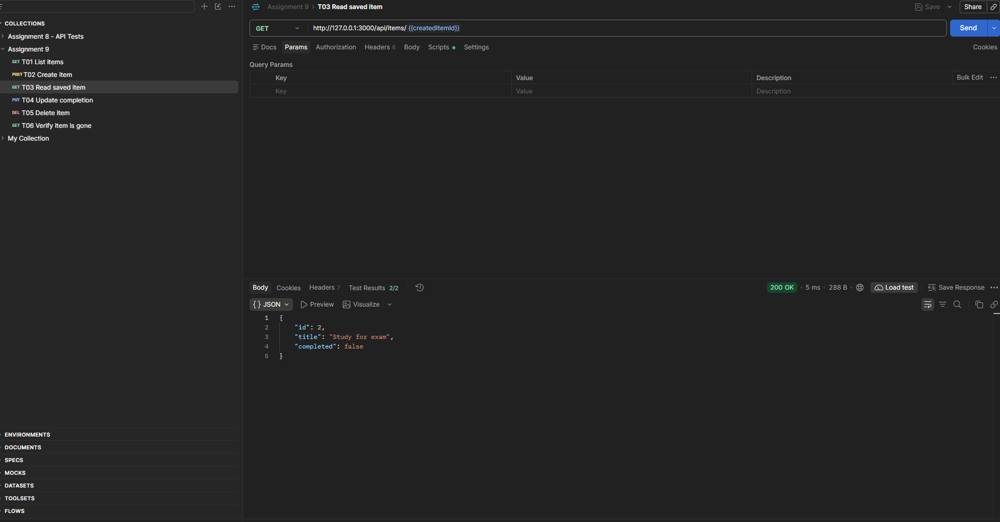
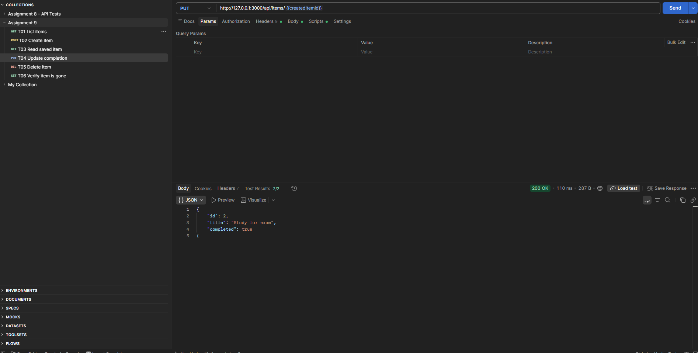
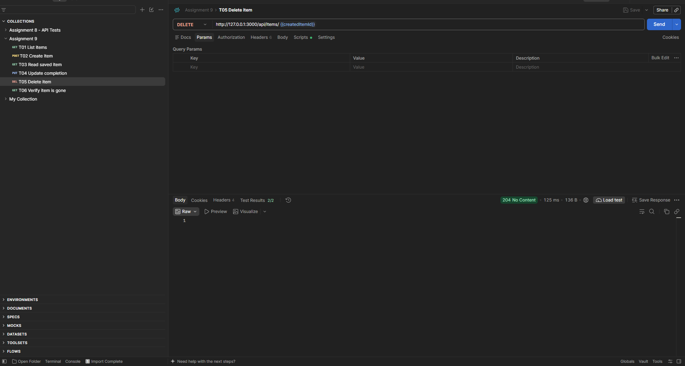
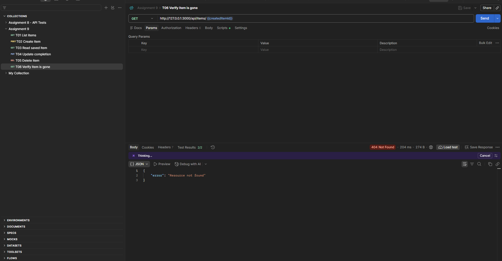

# Assignment 9 Postman Results

## T01 — List items

`GET /api/items` returned **200 OK**. The collection was empty and returned `[]`.

## T02 — Create item

`POST /api/items` returned **201 Created**. Created `Study for exam` with ID `2` and `completed: false`.

## T03 — Read saved item

`GET /api/items/2` returned **200 OK**. Retrieved the item created in T02.

## T04 — Update completion

`PUT /api/items/2` returned **200 OK**. Changed `completed` to `true` and preserved the title and ID.

## T05 — Delete item

`DELETE /api/items/2` returned **204 No Content**. Deleted item `2`. The response body was empty.

## T06 — Verify deletion

`GET /api/items/2` returned **404 Not Found**. The API returned `Resource not found` for the deleted item.

