## T01: Get all resources - 200 OK

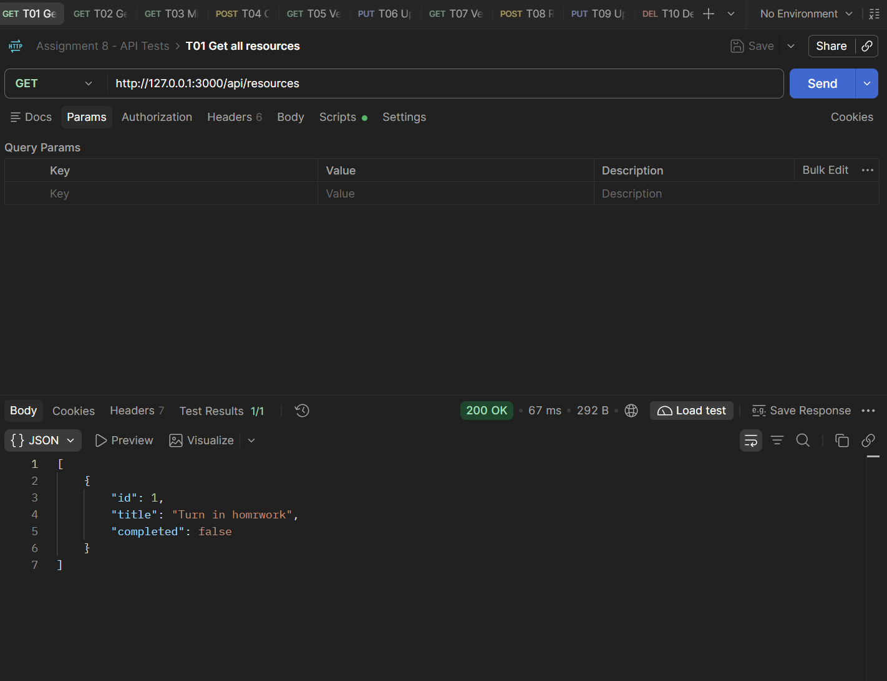

## T02: Get resource by ID - 200 OK

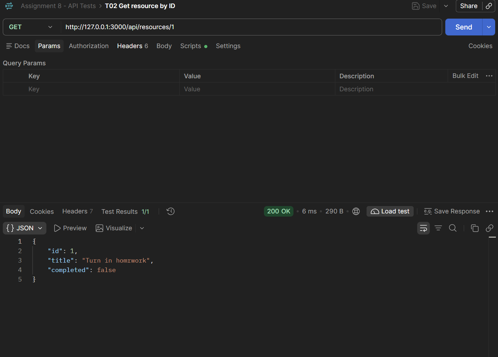

## T03: Get missing resource - 404 Not Found

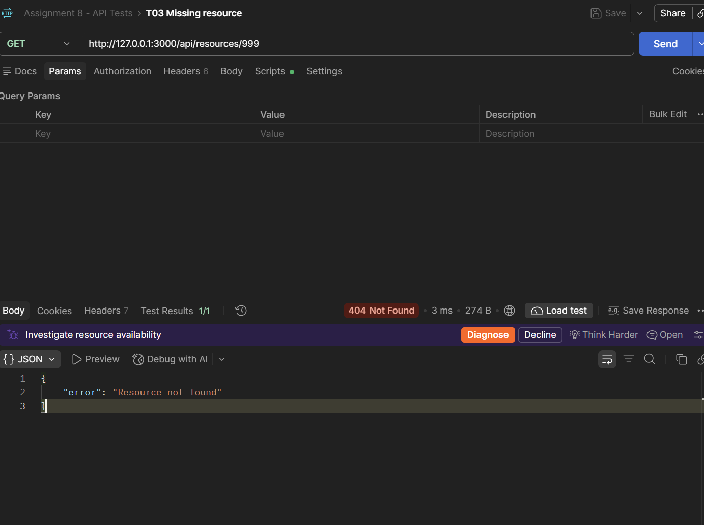

## T04: Create resource - 201 Created

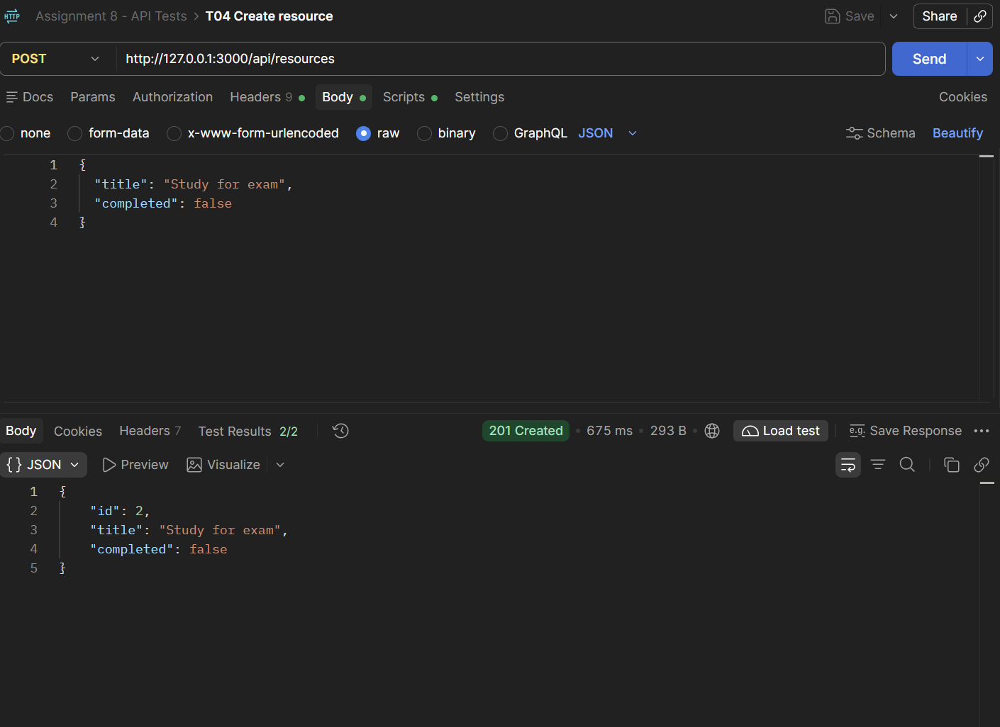

## T05: Verify created resource - 200 OK

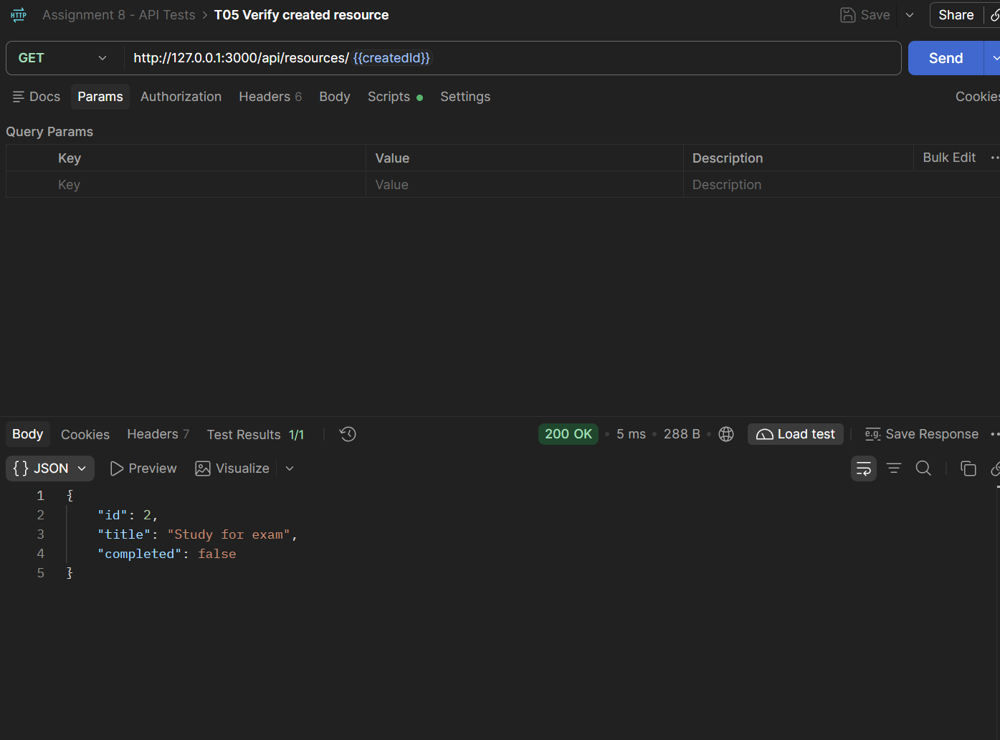

## T06: Update resource - 200 OK

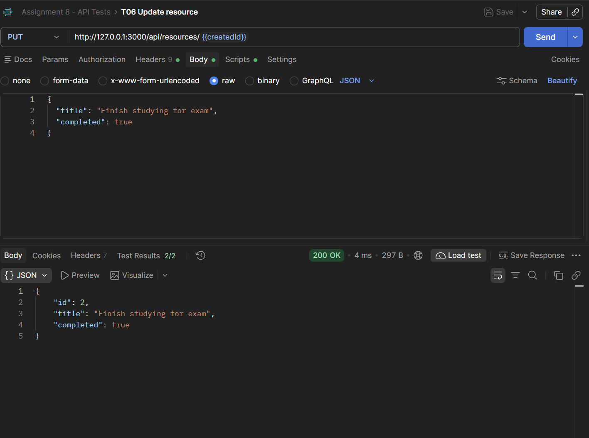

## T07: Verify updated resource - 200 OK

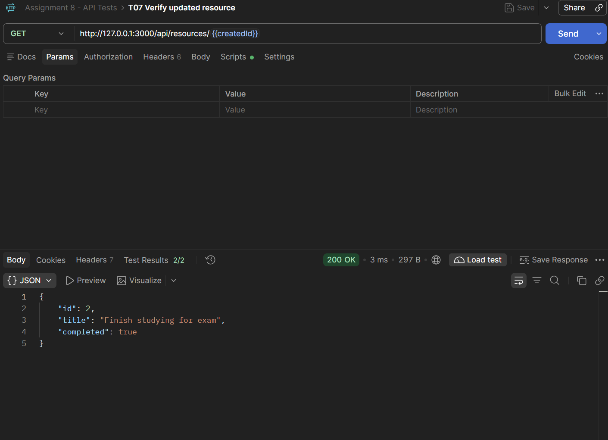

## T08: Reject empty title - 400 Bad Request

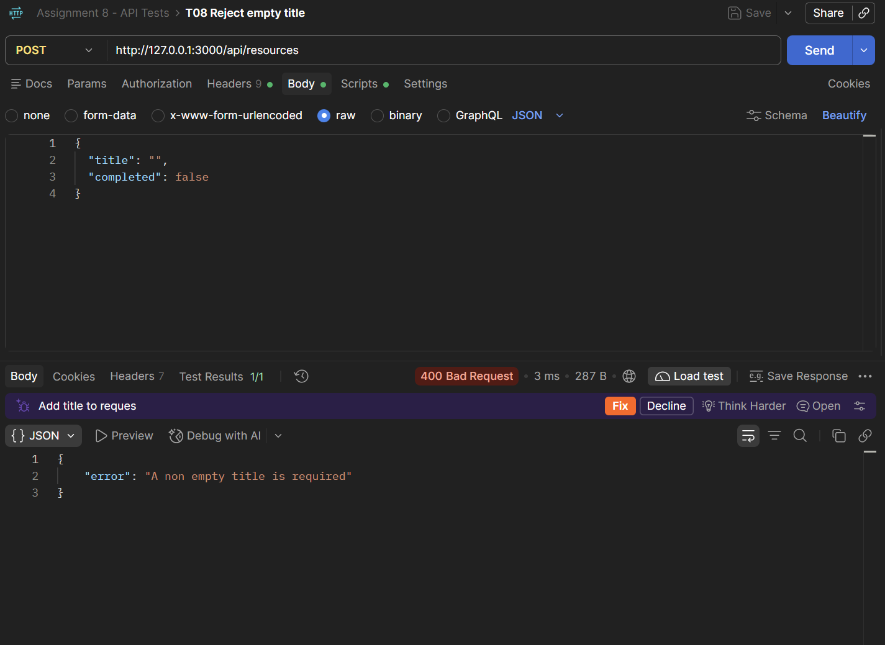

## T09: Update missing resource - 404 Not Found

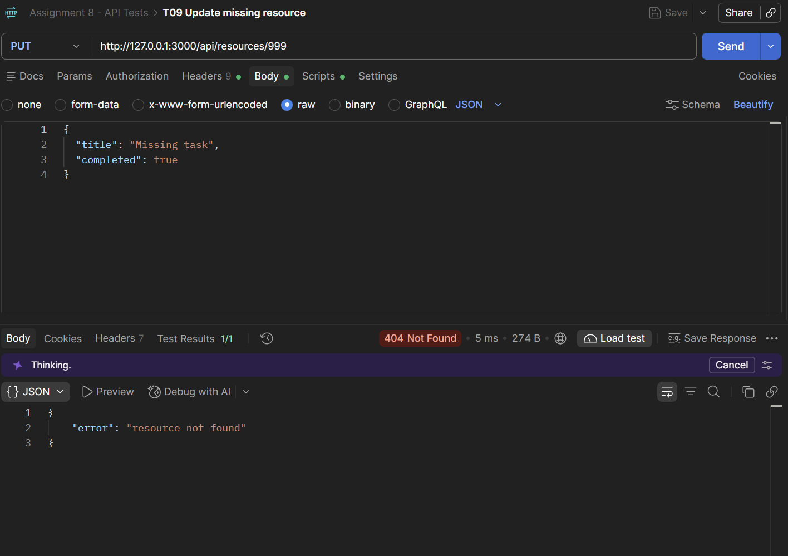

## T10: Delete resource - 204 No Content

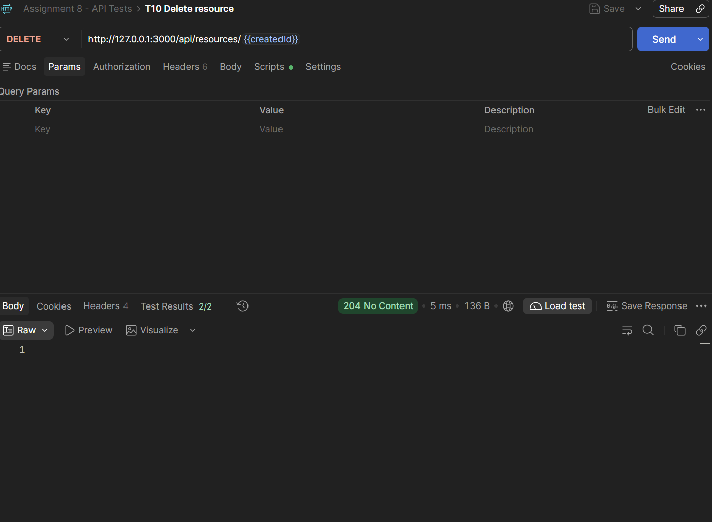

## T11: Verify deleted resource - 404 Not Found

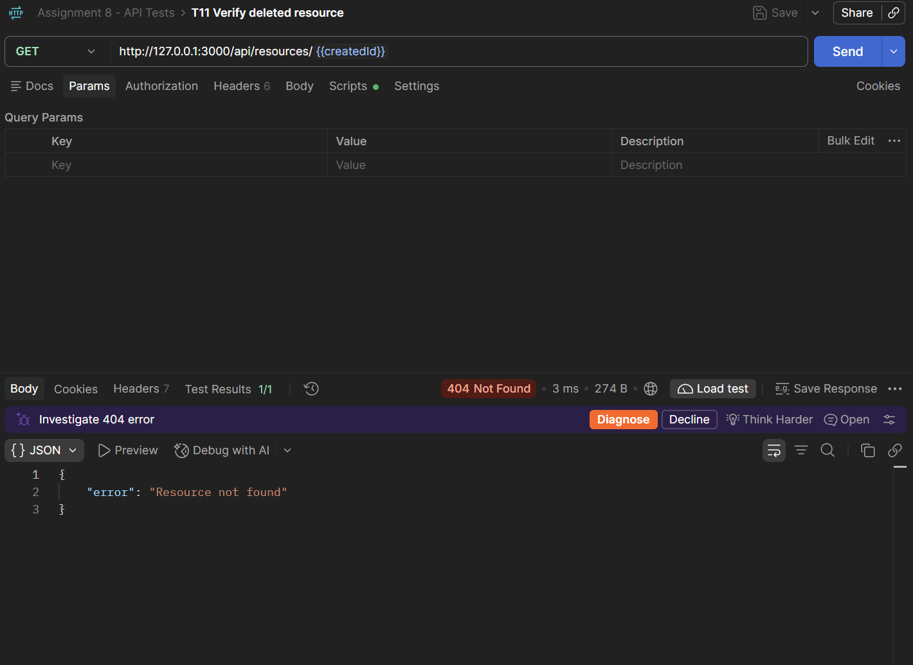

## T12: Delete missing resource - 404 Not Found

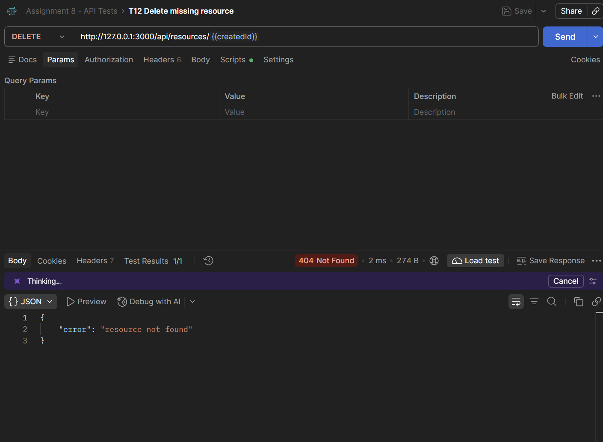
